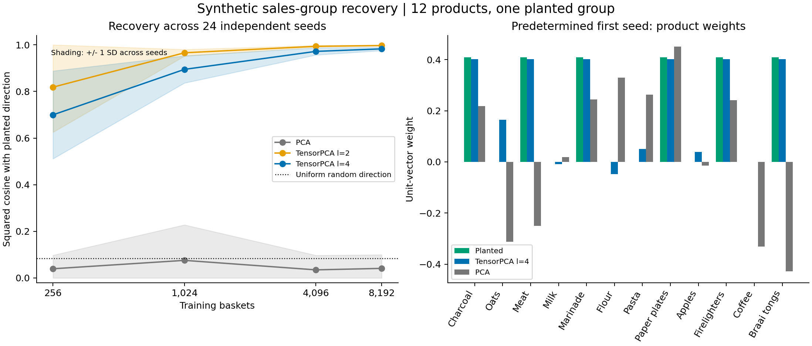

# Synthetic sales-group recovery: reproduced results

Original experiment: 9 November 2026. Reproduced and exported: 11 November 2026.

The original numerical source and seeds were reconstructed from the conversation. All 12 original planted recovery means and both permutation p-values were checked. See `reproduction_check.json` for exact discrepancies.

## Results at 8,192 training baskets

| Method | Mean squared cosine +/- SD | Exact top-six group |
|---|---:|---:|
| PCA | 0.041071 +/- 0.058561 | 0/24 |
| TensorPCA l=2 | 0.996906 +/- 0.001775 | 24/24 |
| TensorPCA l=4 | 0.982626 +/- 0.007174 | 24/24 |

Squared cosine 1 means perfect recovery. Group size is used only for scoring the top-six ranking.

## Sample-size sweep

| Training baskets | PCA | TensorPCA level 2 | TensorPCA level 4 |
|---:|---:|---:|---:|
| 256 | 0.039455 | 0.818418 | 0.699648 |
| 1,024 | 0.075465 | 0.965869 | 0.894696 |
| 4,096 | 0.034734 | 0.993660 | 0.971835 |
| 8,192 | 0.041071 | 0.996906 | 0.982626 |

## Validation and controls

The predetermined first-seed validation permutation test gives p=0.005 for the planted condition and p=0.96 for the null. Each uses 199 permutations, with a minimum attainable p-value of 0.005.

| Condition | Mean level-4 validation contrast +/- SD |
|---|---:|
| planted | 0.439919 +/- 0.015658 |
| null | -0.003682 +/- 0.012715 |

Maximum eigenpair residual across all runs: 1.292e-09.

Exact enumeration confirms the matching first-, second-, and third-order population statistics. Numerical checks compare cumulants with direct centered calculations and Lanczos eigenpairs with a dense solve. Dataset export checks confirm each of the four CSVs matches its packed replicate.

## Interpretation

Higher-order statistics recover the deliberately planted product group in this controlled test. Level 2 performs better than level 4, so these results do not establish an advantage for a larger lift. The implementation is classical and uses the distinct-index Kikuchi operator. Retail realism, recommendation improvement, overlapping groups, and quantum advantage are untested. The README specifies the probability distribution, algorithm, seed schedule, and data format.
